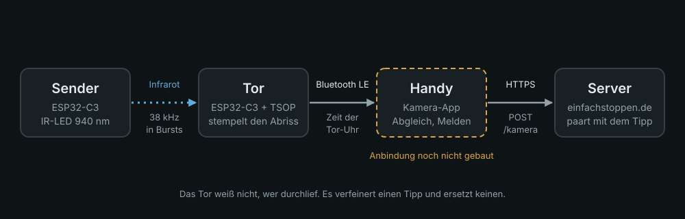
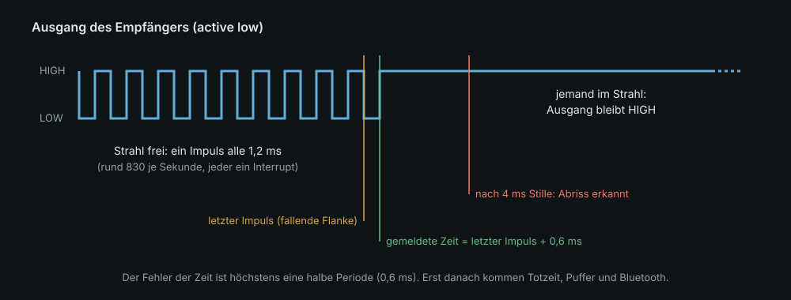

# Architektur

Dieses Dokument erklärt, **wie das Tor gebaut ist und warum**. Das Bluetooth-Protokoll
steht in [protokoll.md](protokoll.md), der Aufbau in [aufbau.md](aufbau.md), die offenen
Messungen in [messung.md](messung.md).

## Ziel und Nichtziele

Das Tor liefert für Start oder Ziel eine **genauere Zeit als ein Tipp mit dem Finger**.
Es ist eine zusätzliche Quelle neben den Taps, so wie die Kamera-App, und es teilt
deren Regel: *Es verfeinert einen Tipp, es ersetzt keinen.*

Nicht Ziel: ein Zeitnahme-System mit Hundertstel-Garantie, eine Teilnehmererkennung
(Transponder, Nummern), ein verkauftes Produkt. Das Tor weiß nicht, **wer** durchlief.

## Bausteine

| Baustein | Aufgabe | Code |
| --- | --- | --- |
| Sender | schickt 38-kHz-Bursts über die Strecke | `src/sender.cpp` |
| Tor (Empfänger) | stempelt den Abriss der Bursts, hält ihn bis zur Bestätigung, funkt ihn | `src/main.cpp`, `src/kern.h` |
| Kamera-App | koppelt, gleicht die Uhr ab, rechnet um, meldet | *noch nicht gebaut* |
| Server | paart den Durchgang mit einem Tipp oder lässt einen Menschen zuordnen | `einfachstoppen.de`, `kamera.paaren()` |

Der Server bekommt **nichts Neues**: ein Durchgang vom Tor ist für ihn ein
Kamera-Durchgang (`POST /api/races/{code}/kamera`, `art` = `ziel` oder `start`).

## Weg eines Durchgangs

1. Bei freiem Strahl zuckt der Ausgang des TSOP-Empfängers etwa 830-mal je Sekunde
   (active low). Jeder Impuls ist ein Interrupt, der nur „zuletzt gesehen“ schreibt.
2. Läuft jemand durch, bleiben die Impulse aus. `tor::Strahl` merkt das nach 4 ms Stille
   und schätzt die Zeit des Abrisses: letzter Impuls + eine halbe Periode (0,6 ms).
3. `tor::Totzeit` lässt nur den ersten Abriss je 300 ms zu (Standard).
4. `tor::Puffer` legt den Durchgang mit `seq` ab und die Firmware funkt ihn per notify.
5. Das Handy rechnet `t_us` in die eigene Uhr um (`versatz` aus dem Sync), meldet an den
   Server und schreibt die Bestätigung zurück. Erst dann verlässt der Durchgang den Puffer.
6. Der Server paart ihn mit einem Tipp, wenn es eindeutig ist, sonst bleibt er offen.

## Drei Uhren

Tor-Uhr (µs seit Start), Handy-Uhr, Server-Uhr. Gemessen wird nur auf der Tor-Uhr. Das Handy
kennt seinen Versatz zum Server schon (`/api/time`) und schätzt den zum Tor beim Sync
(siehe Protokoll). **Die Ankunftszeit eines Pakets zählt nie**: das ist dieselbe Regel wie
bei den Taps im Server, aus demselben Grund.

## Entscheidungen

- **Impulszug statt Flanke.** Ein TSOP-Empfänger schaltet bei Dauerlicht ab (AGC). Der Sender
  schickt deshalb Bursts, und bei freiem Strahl gibt es 830 Flanken je Sekunde. Eine erste
  Fassung wertete jede Flanke als Durchgang; beim Lesen des Vishay-Datenblatts (Rev. 2.4,
  Dok. 82459) fiel das auf, bevor Hardware lief. Jetzt ist ein Durchgang, dass die Impulse
  *aufhören*.
- **Scharf erst nach dem ersten Impuls.** Ein Tor ohne Sender meldet nichts, statt eines
  Durchgangs beim Einschalten.
- **Zeitstempel im Interrupt.** Was zwischen Flanke und Zeitnehmen liegt, wäre Messfehler.
- **Puffer mit Bestätigung statt „senden und hoffen“.** `notify()` meldet in NimBLE-Arduino 1.4
  keinen Fehler. Ob etwas ankam, weiß nur die Bestätigung vom Handy. Ohne sie geht das
  Unbestätigte nach 2 s nochmal raus; Empfänger erkennen Wiederholungen an `boot` + `seq`.
- **Der Stand ist lesbar.** Die Bestätigung ist kumulativ; ohne den Bereich, den das Tor noch
  hält, könnte das Handy eine Zeit löschen, deren Benachrichtigung verloren ging.
- **Läuft der Puffer voll, fällt der älteste weg** und wird gezählt, denn auf den neuesten
  wartet gerade jemand.
- **Bluetooth LE statt WLAN.** Kein Netz, keine Zugangsdaten im Gerät, am Waldrand
  funktioniert es. Preis: iOS-Safari kann kein Web Bluetooth, die Anbindung muss in die
  native Kamera-App.
- **Art (Start/Ziel) wird nicht gespeichert.** Ein Tor, das nach dem Neustart „Start“ meldet,
  weil es gestern dort stand, tut am Ziel still das Falsche. Das Handy setzt sie je Sitzung.
  Die Totzeit dagegen ist ein Gerätewert und wird gespeichert.
- **Außerhalb der Grenzen wird nichts übernommen.** Ein Tippfehler am Handy darf das Tor
  nicht taub machen (Totzeit 20 … 5000 ms).
- **Nie notify unter der Sperre.** Die BLE-Aufgabe hält eine eigene Sperre und will in den
  Callbacks unsere; zwei Sperren in verschiedener Reihenfolge ist ein Stillstand.
- **Die Kernlogik hat keine Arduino-Abhängigkeit** (`src/kern.h`) und läuft auf dem Rechner
  in den Tests.

## Fehlerfälle

| Fall | Verhalten |
| --- | --- |
| Verbindung weg, Durchgänge entstehen | bleiben im Puffer, gehen beim Wiederverbinden mit wahrer Zeit raus |
| Benachrichtigung geht im Funk verloren | nach 2 s ohne Bestätigung nochmal; doppelt zählt nicht |
| Tor startet neu | neues `boot`, `seq` beginnt bei 1, Versatz gilt nicht mehr, Handy gleicht neu ab |
| Sender fällt aus | Impulse bleiben aus: **ein Durchgang wird gemeldet**, danach nichts mehr |
| Strahl flattert (Zweige, Regen) | Totzeit schluckt Folgeabrisse; ein einzelner ausgelassener Impuls ist unter der Haltezeit |
| Direkte Sonne, Leuchtstoffröhre | der Empfänger regelt per AGC ab; **auf echter Hardware nicht geprüft** |

Der Fall „Sender fällt aus“ ist eine echte Schwäche: Das Tor kann einen leeren Akku am
Sender nicht von einem Läufer unterscheiden. Ein Abgleich im Sitzungsablauf (nach dem
Aufstellen einmal durchlaufen, Sender-Akku ausreichend) fängt das ab, die Firmware nicht.

## Sicherheit

- Keine Zugangsdaten, kein Netz, keine Daten über Personen im Gerät.
- Bluetooth ohne Kopplung: **jeder in Funkreichweite** kann Einstellung und Bestätigung
  schreiben, Durchgänge mitlesen und einen Sync auslösen. Schlimmstenfalls: verstellte
  Totzeit (in Grenzen), bestätigte, also gelöschte Durchgänge, gelesene Zeiten. Ob das für
  eine offene Bauanleitung reicht, ist vor dem Veröffentlichen zu entscheiden. Eine
  Kopplung mit Passkey wäre die Antwort und kostet Bedienung am Start.
- Die Meldung an den Server läuft über die Kamera-Schnittstelle und damit über den Code zum
  Mitmachen (`get_race()`); ein Tor kann sie nur mit diesem Code auslösen.

## Was getestet ist und was nicht

- **Getestet** (`tools/test.sh`, per Mutation geprüft): Totzeit, Puffer, Paketformat,
  Erkennung des Strahl-Abrisses in einer Simulation (freier Strahl 10 s, Tor ohne Sender,
  Abriss auf eine halbe Periode genau, Wiederkehren, ein ausgelassener Impuls).
- **Kompiliert** für alle vier Umgebungen (`schreibtisch`, `tor`, `tor_start`, `sender`).
- **Nicht geprüft:** alles, was Hardware braucht – Aufspielen, Koppeln, tatsächliche
  Uhrgenauigkeit über Bluetooth, Reichweite und Sonnenverhalten, Schaltung und Gehäuse.
  Die Versuche dazu stehen in [messung.md](messung.md).
- **Nicht simulierbar:** Bluetooth-Laufzeiten. Ein Rechner-Modell würde die Jitter-Annahme
  einsetzen, die erst gemessen werden soll.
