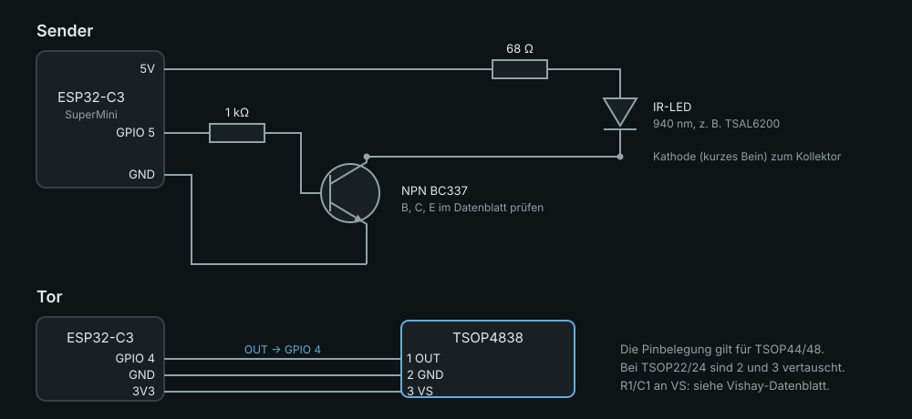
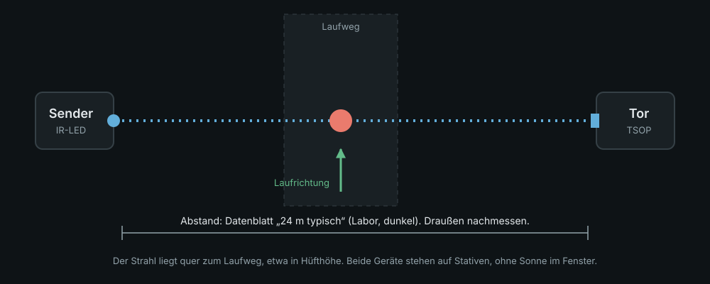

# Aufbau

> **Stand:** Diese Anleitung ist nach Datenblättern und Rechnung geschrieben. **Kein
> Schritt davon wurde bisher an echter Hardware ausgeführt.** Wo etwas gemessen werden
> muss, steht es da. Wenn du es zuerst nachbaust, schreib auf, was abweicht.


> Für den **Startstab** (Stange mit Magnet und Reedkontakt statt Strahl): [startstab.md](startstab.md).

Eine Strecke besteht aus zwei Geräten: dem **Sender** (schickt Infrarot-Bursts) und dem
**Tor** (empfängt sie, meldet das Ausbleiben). Teile: [teileliste.md](teileliste.md).

## 0. Werkzeug einrichten

```
python3 -m venv .venv && .venv/bin/pip install platformio
tools/test.sh        # Kernlogik testen, braucht nur einen C++-Compiler
```

## 1. Test am Schreibtisch, ohne Aufbau

Ein ESP32-C3 genügt. Der BOOT-Taster (GPIO 9) spielt den Strahl.

```
.venv/bin/pio run -e schreibtisch -t upload
.venv/bin/pio device monitor
```

Erwartet im Monitor: beim Start `Tor-XXXX bereit, boot=…`. Beim Drücken von BOOT
`Durchgang bei … us`, ein zweites Drücken innerhalb von 300 ms zählt nicht (Totzeit).

## 2. Sender bauen



| Von | Nach |
| --- | --- |
| GPIO 5 | 1 kΩ → Basis des NPN |
| Emitter | GND |
| Kollektor | Kathode der IR-LED |
| Anode der IR-LED | 68 Ω → 5 V (USB-Pin des Boards) |

Die LED nie direkt am GPIO betreiben: Der Pin liefert nur wenige Milliampere, die LED
braucht rund 50 mA. Die Polung der LED (kurzes Bein = Kathode) und die Pinbelegung des
Transistors im Datenblatt prüfen.

```
.venv/bin/pio run -e sender -t upload
```

Monitor: `Sender: GPIO 5, Traeger 38000 Hz, Bursts 600 us`. Die LED leuchtet für das Auge
nicht. Die Kamera eines Handys zeigt sie meist als helles Violett – ein schneller Test,
ob überhaupt Licht kommt (Kameras ohne IR-Sperrfilter vorausgesetzt, nicht bei jedem Handy).

## 3. Tor bauen

| Empfänger (TSOP48, Pinbelegung im Datenblatt) | Board |
| --- | --- |
| Pin 1 = OUT | GPIO 4 |
| Pin 2 = GND | GND |
| Pin 3 = VS | 3V3 |

Das Datenblatt (Dok. 82459) zeigt R1 und C1 an der Versorgung für den Fall starken Brummens;
Werte dort nachsehen. Auf dem Steckbrett meist unnötig.

```
.venv/bin/pio run -e tor -t upload          # Ziel
.venv/bin/pio run -e tor_start -t upload    # Start
```

## 4. Strecke prüfen



1. Sender und Tor etwa einen Meter gegenüber stellen, Empfänger-Fenster auf die LED
   gerichtet, Monitor am Tor offen.
2. **Strahl frei:** im Monitor darf **nichts** erscheinen. Kommt ein `Durchgang`, ohne dass
   jemand durchlief, ist der Aufbau zu dicht an einem Störer (Sonne, Lampe) oder falsch
   ausgerichtet.
3. **Hand durch den Strahl:** genau ein `Durchgang bei … us`. Hand bleibt drin: kein zweiter.
4. Hand raus, wieder rein: nach 300 ms ein neuer.
5. Sender ausschalten: **ein** Durchgang (das Tor kann das nicht von einem Läufer
   unterscheiden, siehe [Architektur](architektur.md#fehlerfälle)).

Wie die Zeit des Abrisses entsteht, zeigt das Signalbild in der
[Architektur](architektur.md#weg-eines-durchgangs).

## 5. Reichweite und Sonne – messen, nicht annehmen

Das Datenblatt nennt für den Empfänger „24 m typisch“, gemessen im Dunkeln mit dem
TSAL6200 bei 50 mA, und einen halben Öffnungswinkel von ±45°. Im Freien wird es weniger
sein. Steigere den Abstand in Schritten (2, 5, 10 m) und notiere, wo der Strahl im
Sonnenlicht noch hält. Ein Röhrchen (Schrumpfschlauch) vor LED und Empfänger bündelt;
dann muss genauer ausgerichtet werden.

## 6. Gehäuse

[`gehaeuse/tor.scad`](../gehaeuse/tor.scad) ist ein parametrisches OpenSCAD-Modell, das
sich für Sender und Tor umstellen lässt. **Es wurde weder gerendert noch gedruckt.** Alle
Maße oben in der Datei an das echte Board anpassen (Länge, Breite, Dicke messen).

## 7. Mit dem Handy verbinden

Die Kamera-App („einfachstoppen Kamera“, ab Release 0.3.0, als [TestFlight-Beta für
iPhone](https://einfachstoppen.de/#/kamera)) findet das Tor unter `Tor-XXXX`, koppelt, gleicht
die Uhr ab und meldet die Durchgänge. Auf der Auswahlseite vor der Sitzung wählst du die Rolle
(Start oder Ziel) und als Messart **Tor**. Die Anbindung ist gebaut und am Rechner getestet,
**am Gerät aber nicht geprüft**. Das Protokoll steht in [protokoll.md](protokoll.md); ohne die
App kann man das Tor aufbauen und im Monitor beobachten, aber keinen Lauf stoppen.
