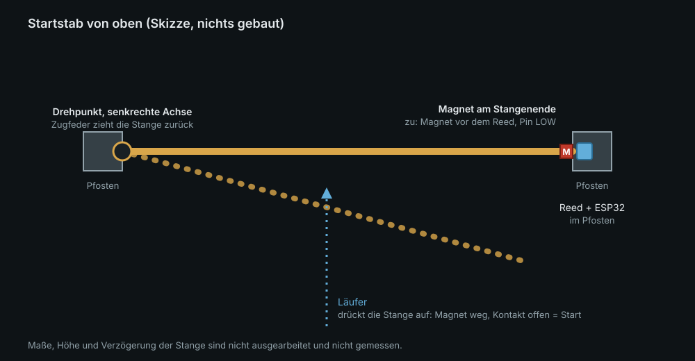
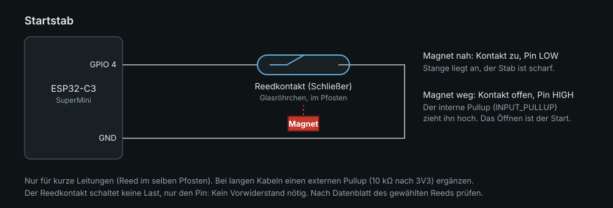
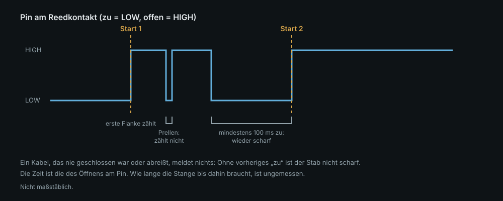

# Startstab

> **Stand:** Der Startstab ist wie das Tor nach Datenblättern und Überlegung entworfen.
> **Nichts davon wurde gebaut, gedruckt oder gemessen.** Die Firmware kompiliert, ihre
> Kernlogik ist getestet. Wo etwas gemessen werden muss, steht es da. Wenn du ihn zuerst
> nachbaust, schreib auf, was abweicht.

Der Startstab ist das Gegenstück zur Lichtschranke für den **Start**, wie man ihn vom
Skirennen kennt: Zwei Pfosten, dazwischen eine schwenkbare Stange. Wer losläuft oder
losfährt, drückt sie auf. Statt eines Strahls öffnet sich ein Kontakt.



Für die App ist er **dasselbe Gerät wie das Tor**: Er funkt dasselbe Bluetooth-Protokoll
([protokoll.md](protokoll.md)) und meldet Durchgänge mit `art = start`. Die Kamera-App und der
Server merken keinen Unterschied. Nur der Sensor ist ein anderer.

## Wie es funktioniert

Am Stangenende sitzt ein Magnet, im Pfosten ein Reedkontakt (Schließer) am Pin GPIO 4. Liegt
die Stange an, ist der Kontakt zu und der Pin LOW. Drückt jemand sie auf, entfernt sich der
Magnet, der Kontakt öffnet und der Pin geht auf HIGH. **Das Öffnen ist der Start.**



Einfach „jede Flanke zählt“ reicht nicht. Eine Stange, die zurückfedert, prellt. Ein Windstoss
oder eine Hand bewegt sie, ein Kabel reißt ab. Jedes davon wäre ein Start. Die Firmware
(`tor::Kontakt` in `src/kern.h`) zählt das Öffnen deshalb nur, wenn der Kontakt vorher
**mindestens 100 ms am Stück zu** war:



- Die **erste** Öffnungsflanke gibt die Zeit, nicht die letzte.
- Prellen beim Öffnen und beim Zurückfedern zählt nicht.
- Ein Kabel, das beim Einschalten ab ist oder später abreißt, meldet **nichts**. Ein Stab ohne
  vorheriges „zu“ ist nicht scharf. Das ist Absicht und dieselbe Regel wie beim Tor ohne
  Sender, aber es heißt auch: Ein defekter Kontakt fällt nur auf, wenn man nach dem
  Aufstellen einmal die Stange aufdrückt und im Monitor oder in der App den Durchgang sieht.
- Drückt jemand die Stange auf, bevor sie 100 ms an lag (etwa direkt nach dem Einschalten),
  zählt das nicht.

## Teile

Siehe [teileliste.md](teileliste.md), Abschnitt „Startstab“. Gehäuse und Halter:
[`gehaeuse/tor.scad`](../gehaeuse/tor.scad) mit `variante="stab"` für den ESP32,
[`gehaeuse/stab.scad`](../gehaeuse/stab.scad) für den Magnet- und den Reedhalter. **Weder
gedruckt noch am echten Teil geprüft.** Alle Maße oben in den Dateien an die echten Teile
anpassen.

## 1. Test am Schreibtisch

Ein ESP32-C3 und ein Stück Draht genügen. Anstelle des Reeds hält man ein Drahtstück
zwischen GPIO 4 und GND.

```
.venv/bin/pio run -e startstab -t upload
.venv/bin/pio device monitor
```

Erwartet im Monitor: beim Start `Tor-XXXX bereit, boot=…, art=1`.

1. Draht an GPIO 4 und GND halten, **eine Sekunde warten**, Draht lösen: **ein**
   `Durchgang bei … us`.
2. Draht kurz (unter 100 ms) an GND tippen und wieder lösen: **nichts**.
3. Draht anlegen, lösen, sofort wieder anlegen und lösen: nur der erste zählt.
4. Draht beim Einschalten **nicht** anlegen, später lösen: nichts (nie scharf).

## 2. Mechanik: ein Vorschlag, nicht erprobt

Das ist Handwerk, kein Elektronikproblem. Wie es gelöst wird, ist offen; so würde ich anfangen:

- **Zwei Pfosten**, etwa Kantholz 40 × 40 mm oder Rohr, mit Fuß oder im Boden. Höhe so, dass
  die Stange etwa in Hüfthöhe liegt. Der Abstand ist das, was durchpassen soll.
- **Stange:** ein Rundstab (Holz, Glasfaser, Alu) von etwa 12 mm. Er ist an einem Pfosten
  drehbar befestigt, mit **senkrechter Achse** wie bei einem Gartentor, und liegt am anderen
  Pfosten an.
- **Rückstellung:** eine Zugfeder oder ein Gummi zieht die Stange gegen den Anschlag am
  zweiten Pfosten. Die Stange muss **von allein zurückkommen**, sonst bleibt der Stab nach dem
  ersten Start offen und meldet nichts mehr.
- **Magnet:** der Halter `stab_magnethalter` klemmt am Stangenende und hält einen
  Scheibenmagneten mit der Stirnseite nach vorn.
- **Reed:** der Halter `stab_reedhalter` wird mit zwei Holzschrauben an den Pfosten
  geschraubt und hält das Glasröhrchen so, dass es dem Magneten bei anliegender Stange
  gegenübersteht. Das Röhrchen nicht mit der Zange biegen, Glas bricht an der Einschmelzung.
- **ESP32:** im Gehäuse `stab_unten` mit dem Deckel `tor_deckel`, am selben Pfosten nahe am Reed,
  damit das Kabel kurz bleibt.

## 3. Magnet und Reed abstimmen – messen, nicht annehmen

Ab welchem Abstand ein Reed schaltet, hängt von seiner Empfindlichkeit (Ampere-Windungen) und
vom Magneten ab. Das Datenblatt des gewählten Reeds nennt die Größenordnung, die Praxis
weicht ab.

1. Reed an den ESP32, Monitor offen, Magnet von Hand nähern und entfernen.
2. Bei welchem Abstand schaltet er an, bei welchem aus? Beides aufschreiben (Hysterese).
3. Den Abstand bei anliegender Stange so wählen, dass der Magnet **sicher** schaltet, also mit
   deutlichem Spielraum zum Schaltpunkt.
4. Stange aufdrücken: schaltet er **früh** (bei wenigen Millimetern) oder erst spät? Je früher,
   desto genauer die Zeit. Kleiner Abstand bei anliegender Stange, kurzer Schaltweg.

## 4. Strecke prüfen

1. Stab aufstellen, Powerbank, Monitor offen.
2. Stange anliegen lassen und zehn Sekunden warten: im Monitor darf **nichts** erscheinen.
3. Stange aufdrücken, loslassen: genau **ein** `Durchgang`. Zurückfedern ohne zweiten.
4. Stange erneut aufdrücken, nachdem sie wieder anlag: ein neuer Durchgang.
5. Kabel am Reed abziehen und die Stange aufdrücken: **nichts**. Das ist gewollt. Danach
   prüfen, ob die Anwendung (Aufstellen und einmal durchlaufen) diesen Fall abfängt.

## 5. Mit dem Handy verbinden

Wie beim Tor: Die Kamera-App (Release 0.3.0) findet das Gerät unter `Tor-XXXX`. Wähle in der
App die Rolle **Start**; die Art kommt vom Handy, nicht vom Gerät. Das Gerät meldet ohne
Einstellung `art = start`, denn die Umgebung `startstab` setzt sie. **Am Gerät nicht
geprüft.**

## Was offen ist

- **Die Verzögerung der Stange** ist ungemessen: Der Kontakt öffnet erst, wenn die Stange ein
  Stück offen ist. Das ist eine feste Zeit plus Streuung je nach Kraft und Geschwindigkeit.
  Wie groß, steht in keiner Quelle. Der Versuch dazu steht in [messung.md](messung.md)
  (Versuch 4).
- **Ob die Streuung kleiner ist als beim Tipp mit dem Finger,** ist offen. Ohne Messung ist der
  Startstab eine Zeitquelle, kein Genauigkeitsversprechen.
- **Mechanik und Gehäuse** sind nicht gebaut oder gedruckt.
- **Wetter:** Feuchtigkeit, Schnee und Frost an Scharnier, Feder und Reed sind nicht
  geprüft.
- **Offizielle Wettkämpfe** verlangen geprüfte Zeitnehmer mit Ersatzsystem. Das hier ist für
  Vereinsrennen und Training.
